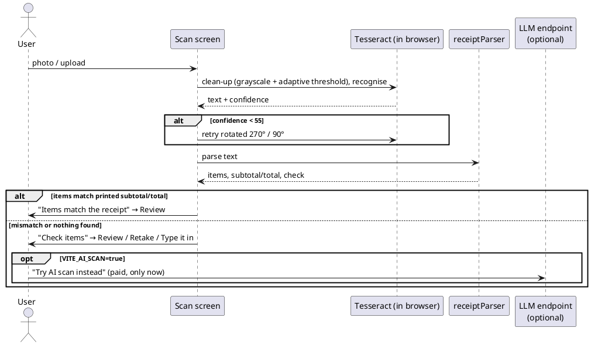

# Splitto design

Splitto is a mobile-first PWA for splitting a restaurant bill: scan the receipt, say who had what, share the result.

- **Look and layout:** taken from the Dribbble reference (dashboard cards, a vertical "Add bill" pill, avatar tiles, a dark centre nav button, an onboarding illustration).
- **Colours, type, radius:** taken from the **Nanashi design system** ([artifact](https://claude.ai/artifact/XZTDMvwPSHyb8PfYPK3JCj)). Splitto is a Nanashi product using the default **violet** accent.
- **Code:** all tokens live in `client/src/index.css`, and components only use the semantic names below.

---

## 1. Principles

1. **Phone first.** Designed at 390 px wide. Content is capped at 448 px (`max-w-md`) on larger screens. Every tap target is at least 44 px.
2. **One action per screen.** There is one primary (violet) button per view, pinned to the bottom where the thumb is.
3. **Neutral sky, violet for actions, gold is rare.** About 80% Moon neutrals, 15% violet, at most 5% Star Gold. Gold marks one highlight per screen (the "In progress" badge, the star in the illustration).
4. **Trust the numbers.** Totals always reconcile to the rupiah. When the scanner is unsure, the screen says so; it never guesses quietly.
5. **Motion explains, never decorates.** Animations are short (120–420 ms) and ease out. They never block input and switch off under "reduce motion".

## 2. Colour tokens (Nanashi, violet accent)

| Token | Light | Dark | Used for |
| --- | --- | --- | --- |
| `bg` | #FBFAFD | #0F0D14 | Page background |
| `surface` | #FFFFFF | #18161F | Cards, sheets, inputs |
| `surface-raised` | #F6F5F9 | #221F2D | Hover, segmented control track |
| `border` | #E0DDE8 | #2D2A3A | Card hairlines (cards use borders, not shadows) |
| `border-strong` | #7B768C | #7B768C | Input and secondary-button borders |
| `text` | #1F1A2B | #EEECF3 | Body and headings |
| `muted` | #5D5870 | #A29DB2 | Labels, captions |
| `primary` | #6A3BC6 | #A283E6 | Buttons, links, active nav, selected items |
| `primary-subtle` | #EDE7FB | #271D3F | Selected person or item background |
| `on-primary` | #FFFFFF | #0F0D14 | Text on primary |
| `star` / `on-star` | #FFC857 / #2E1458 | same | The one highlight badge (fill only, never as text on light) |
| `success` | #177A55 | #3EB489 | "Items match the receipt" |
| `warning` | #B4530F | #F5A65B | "Check items", unassigned items |
| `danger` | #C8384F | #F07A8C | Remove, errors |
| `night` | #0F0D14 | #0F0D14 | Scanner, onboarding sky, summary hero |
| `tile-1…5` | Nanashi accent "subtle" tints | dark equivalents | Avatar tile backgrounds only |

**Rules:**

- Status is never shown by colour alone; it always comes with an icon or a label.
- Indigo #4B0082 (the logo colour) is not used in the product.
- The footer says "A Nanashi project" as plain text, because the logo files are not in this repo.

## 3. Type, spacing, shape

- **Headings:** Sora 600. Sizes: 28/36 (page title), 22/28 (section), 17/24 (card title).
- **Body:** Plus Jakarta Sans, 15/24. Small text is 13/20 and labels 12/16.
- **Money:** always set in tabular figures, so digits don't jump as totals change.
- **Fonts are self-hosted** (`@fontsource`), so they work offline.
- **Spacing:** steps of 4, 8, 12, 16, 24 and 32 px. The mobile gutter is 16 px.
- **Radius:**
  - 6 px: inputs
  - 10 px: buttons
  - 16 px: list cards
  - 20–24 px: hero and dashboard cards, sheets
  - Avatar tiles are rounded squares (12–18 px).
- **Shadow:** `shadow-pop` is used only on sheets, toasts and the centre nav button.

## 4. Components

| Component | File | Notes |
| --- | --- | --- |
| Button | `components/ui/Button.tsx` | `primary`, `secondary`, `ghost`, `danger`, `dark` (inverts in dark mode). Shrinks slightly on press. |
| IconButton | same | 44 × 44 px, always has an `aria-label`. |
| Avatar | `components/ui/Avatar.tsx` | Illustrated avatar on a pastel tile, as in the reference "Recent friends" row. |
| Sheet | `components/ui/Sheet.tsx` | Bottom sheet on phones, centred dialog on desktop. Closes with Esc or a backdrop tap, and returns focus to where it was. |
| MoneyField / PercentField | `components/ui/Fields.tsx` | Rupiah input with live thousand separators. Stores whole numbers. |
| Segmented, QtyStepper | same | Discount Rp/%; quantity −/+ buttons. |
| Money | `components/ui/AnimatedNumber.tsx` | Totals count up or down to the new value instead of jumping. |
| FlowHeader | `components/layout/FlowHeader.tsx` | Back button, title, and a 3-step stepper (Items → People → Split). |
| BottomNav | `components/layout/BottomNav.tsx` | Home, Activity, **Scan** (raised dark circle), Manual entry, Friends. |

## 5. Screens (mapped to the reference)

| Screen | Route | Reference element reused |
| --- | --- | --- |
| Onboarding | `/` | "Save your time and money" card: night-sky illustration, dots, dark "Get started" |
| Home | `/app` | "Dashboard": vertical violet *Scan bill* pill, bill cards ("Total bill / Split to"), *Recent friends* tiles |
| Scanner | `/scan` | Full-screen camera, corner brackets, sweep line, result sheet |
| Items | `/bill/items` | Editable item rows, plus discount, service and tax |
| People | `/bill/people` | Avatar strip ("Who's sharing the bill"). Pick a person, then tap their items |
| Summary | `/bill/summary`, `/history/:id` | Per-person cards that expand. Share as text, image or PDF |
| Activity | `/app/activity` | "Your wallet": month total, bar chart with tooltip, list of bills |
| Friends | `/app/friends` | Everyone you've split with |

## 6. Micro-animations

| What | How | Why |
| --- | --- | --- |
| Screen enter | fade + rise 10 px, 320 ms | Tells you where you are |
| List items | rise in with a 45 ms stagger | Lists feel built, not dumped |
| Press | scale to 0.97 (not while a nested button is pressed) | Instant touch feedback |
| Totals | numbers count to the new value over 420 ms | Shows the effect of an edit |
| Assigning someone | avatar pops in with a spring | Confirms the tap |
| Stepper | connector line fills over 500 ms | Shows progress |
| Scanner | brackets pulse, sweep line, progress ring | Shows that work is happening during OCR |
| Result chip | pop in; error sheet shakes once | Draws the eye to "matches" or "check" |
| Summary | a tick draws itself; gold star twinkles | A moment of completion |
| Expand/collapse | animated height (grid rows 0fr → 1fr) | No jump in layout |

All of these are disabled under `prefers-reduced-motion`.

## 7. Money rules (how the split is calculated)

Code is in `client/src/features/bill/split.ts`, with tests in `split.test.ts`.

1. All money is whole Rupiah.
2. A line's cost is split equally between the people assigned to it.
3. The discount comes off the items total.
4. Service = service % × (items − discount).
5. Tax (PB1) = tax % × (items − discount + service).
6. Discount, service and tax are shared in proportion to what each person ordered.
7. Rounding uses the **largest-remainder method**, so the per-person totals add up **exactly** to the bill.
8. You can't continue until every item is assigned.

## 8. Receipt scanning: from a paid LLM to free on-device OCR

**Decision:**

- Scanning now uses **Tesseract (WebAssembly) running on the phone**, followed by a deterministic receipt parser.
- The old GPT-4o-mini endpoint is kept as an **optional fallback**. It is off by default (`VITE_AI_SCAN=true` turns it on). It is only offered when the free scan could not reconcile the receipt.

**Measured on the 10 sample photos in `model/SampleData.zip`:**

- **Speed:** about 1 s per receipt in headless Chromium on a desktop CPU. Expect roughly 2–5 s on a mid-range phone; this has not been measured on a real device yet.
- **Exact matches:** 4 of 10 receipts are read and add up exactly to the printed total (`check.matches`).
- **Partial reads:** most of the rest are partly right (most prices, some names garbled). They are flagged for review instead of being silently wrong.
- **Hardest cases:** busy backgrounds (wood grain) and sideways photos. Sideways photos are handled by the rotation retry.

**Cost and size:**

- No per-scan cost.
- About 7 MB is downloaded once on the first scan (engine about 4 MB plus English model about 3 MB). The service worker then caches it, so later scans work offline.
- The files are self-hosted under `/ocr`, so no third-party CDN is involved.
- Receipt photos never leave the phone.

**Alternatives considered:**

| Option | Cost per scan | Accuracy | Why not (now) |
| --- | --- | --- | --- |
| **Tesseract on device + parser (chosen)** | Rp 0 | Medium | — |
| Self-hosted PaddleOCR (Python container) | Rp 0, plus about one small VM | Higher on photos | Adds a service to run and monitor. Revisit if review edits stay high. |
| LLM only (previous) | Paid every scan | Highest | Cost grows with every scan. Kept as a fallback for hard receipts only. |

**What to measure next:**

- **Share of scans that reconcile.** Log `check.matches` without the receipt contents. If it stays under about 60% on real usage, try PaddleOCR or turn on the AI fallback.
- **Edits per scanned bill.**
- **Time to first result on a low-end Android phone.**

## 9. Accessibility

- Text tokens meet 4.5:1 contrast in both themes.
- Every interactive element shows a 2 px violet focus ring.
- Icon-only buttons have labels.
- The item cards on the People screen are real buttons (no nested buttons) with `aria-pressed`.
- Sheets are proper dialogs.
- Totals and OCR progress are announced (`aria-live`).
- Status always has an icon or a label, not colour alone.
